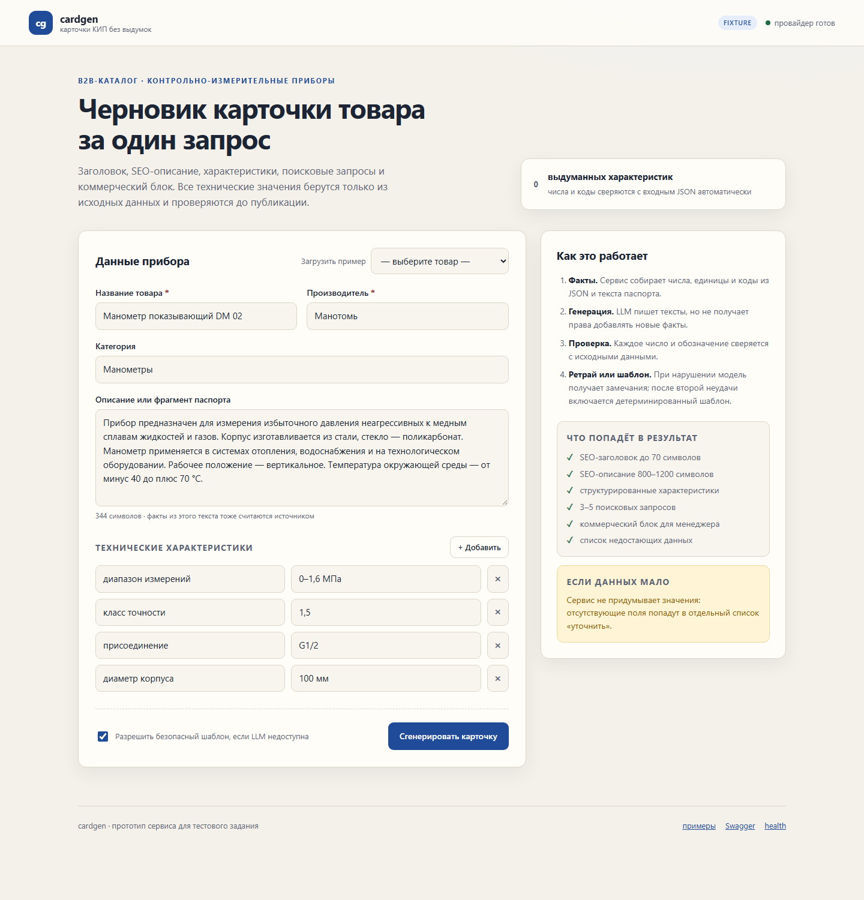
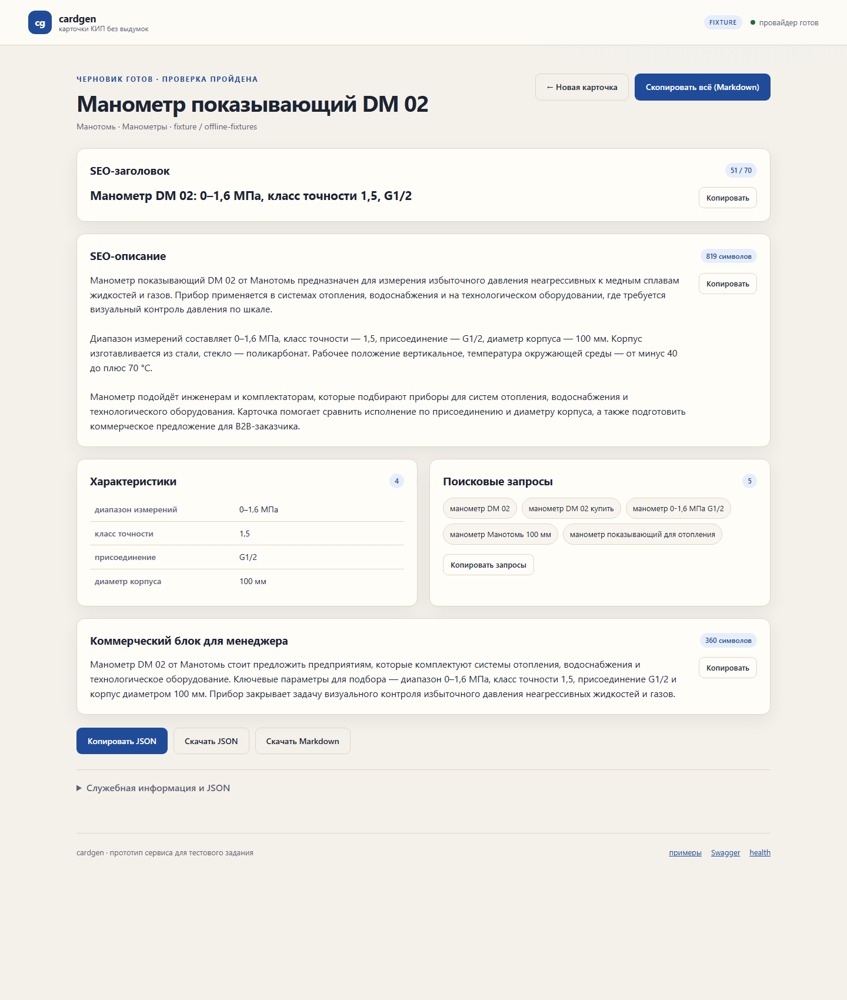

# cardgen — AI-карточки контрольно-измерительных приборов

[](https://github.com/SanKdrv/cardgen/actions/workflows/ci.yml)
[](LICENSE)

Сервис принимает данные о приборе — JSON или заполненную форму — и возвращает
черновик карточки товара для B2B-каталога: SEO-заголовок, SEO-описание,
структурированные характеристики, поисковые запросы и коммерческий блок
для менеджера.

**Главный принцип: модель не имеет права выдумывать характеристики.**
Ответ LLM проходит детерминированную проверку по исходным данным. Если
проверка не пройдена — модель получает замечания и исправляет ответ; после
второй неудачи сервис собирает карточку безопасным шаблоном, а не отдаёт
непроверенный текст.

| | |
|---|---|
| Язык | Python 3.11+ |
| API | FastAPI + Pydantic v2 |
| LLM | любой OpenAI-совместимый API: OpenCode Go, OpenAI, DeepSeek, Ollama, vLLM |
| Интерфейсы | JSON API, веб-форма, CLI |
| Тесты | 247 тестов, покрытие 92% |
| Зависимости | без LangChain и SDK провайдеров |



---

## Содержание

- [Демо и примеры](#демо-и-примеры)
- [Быстрый старт](#быстрый-старт)
- [Настройка провайдера](#настройка-провайдера)
- [Как это работает](#как-это-работает)
- [API](#api)
- [Веб-форма](#веб-форма)
- [CLI](#cli)
- [Офлайн-режимы](#офлайн-режимы)
- [Тесты и качество кода](#тесты-и-качество-кода)
- [Docker](#docker)
- [Структура проекта](#структура-проекта)
- [Ограничения и развитие](#ограничения-и-развитие)

---

## Демо и примеры

В [`examples/output`](examples/output) — **17 карточек** для разных ситуаций:
полные данные, пропуски, placeholder-значения, пустые `specs`, только
описание паспорта, длинный набор характеристик, латинские единицы и разные
категории КИП. Полный разбор кейсов — в [`examples/README.md`](examples/README.md).

Ключевые примеры:

| Товар | Результат | Особенность |
|---|---|---|
| Манометр DM 02 | [Markdown](examples/output/01-manometr-pokazyvayuschiy-dm-02.md) · [JSON](examples/output/01-manometr-pokazyvayuschiy-dm-02.json) | полный набор данных |
| Термометр ТБ-1 | [Markdown](examples/output/02-termometr-bimetallicheskiy-tb-1.md) · [JSON](examples/output/02-termometr-bimetallicheskiy-tb-1.json) | нет класса точности — сервис явно пишет об этом |



Примеры получены живым прогоном через OpenCode Go (`deepseek-v4.1-flash`).
Там, где модель не прошла автопроверку, в `meta.fallback_used` и
`examples/README.md` явно отмечен безопасный шаблон. Воспроизвести без ключа
можно в офлайн-режиме `CARDGEN_PROVIDER=fixture` — команда ниже.

```bash
# живой прогон (нужен ключ в .env)
cardgen generate --input examples/products.json --output artifacts

# без ключа и сети
CARDGEN_PROVIDER=fixture cardgen generate \
  --input examples/products.json --output artifacts
```

Входные данные: [`examples/products.json`](examples/products.json),
пример запроса к API: [`examples/request-dm02.json`](examples/request-dm02.json).

---

## Быстрый старт

```bash
git clone https://github.com/SanKdrv/cardgen.git && cd cardgen
python -m venv .venv
source .venv/bin/activate          # Windows: .venv\Scripts\activate
pip install -e ".[dev]"
cp .env.example .env               # Windows: copy .env.example .env
# заполните CARDGEN_API_KEY
pre-commit install --install-hooks
pre-commit install --hook-type commit-msg
pre-commit install --hook-type pre-push
uvicorn cardgen.api:app --reload
```

Откройте <http://127.0.0.1:8000>.

Без ключа сервис тоже запускается: запрос к LLM завершится понятной ошибкой,
и будет использован детерминированный шаблон с пометкой
`meta.fallback_used = true`.

Проверка конфигурации:

```bash
cardgen check-config
```

---

## Настройка провайдера

Все настройки — переменные окружения с префиксом `CARDGEN_` или файл `.env`.
Ключ никогда не хранится в коде; `.env` добавлен в `.gitignore`.

### OpenCode Go (вариант по умолчанию)

```dotenv
CARDGEN_PROVIDER=openai
CARDGEN_BASE_URL=https://opencode.ai/zen/go/v1
CARDGEN_MODEL=deepseek-v4.1-flash
CARDGEN_API_KEY=...
CARDGEN_SESSION_HEADER=x-opencode-session
```

Шлюз OpenCode Go требует идентификатор сессии в заголовке. Клиент
генерирует его автоматически (`ses_<uuid>`), если `CARDGEN_SESSION_HEADER`
задан. Для OpenAI/DeepSeek/Ollama оставьте переменную пустой.

### OpenAI

```dotenv
CARDGEN_BASE_URL=https://api.openai.com/v1
CARDGEN_MODEL=gpt-4o-mini
CARDGEN_API_KEY=sk-...
CARDGEN_SESSION_HEADER=
```

### Ollama или vLLM (локальный контур)

```dotenv
CARDGEN_BASE_URL=http://localhost:11434/v1
CARDGEN_MODEL=qwen2.5:14b
CARDGEN_API_KEY=ollama
CARDGEN_SESSION_HEADER=
```

Клиент использует только `POST /chat/completions`, поэтому подходит любой
совместимый сервер. Никакой SDK не нужен.

| Переменная | По умолчанию | Назначение |
|---|---|---|
| `CARDGEN_PROVIDER` | `openai` | `openai`, `fixture` или `template` |
| `CARDGEN_BASE_URL` | `https://opencode.ai/zen/go/v1` | базовый URL API |
| `CARDGEN_MODEL` | `deepseek-v4.1-flash` | имя модели |
| `CARDGEN_API_KEY` | — | ключ, только через env |
| `CARDGEN_SESSION_HEADER` | `x-opencode-session` | заголовок сессии для шлюза |
| `CARDGEN_MAX_ATTEMPTS` | `2` | попытки LLM с корректировкой |
| `CARDGEN_MAX_RETRIES` | `3` | HTTP-ретраи на 429/5xx |
| `CARDGEN_TIMEOUT_S` | `180` | таймаут запроса |
| `CARDGEN_TEMPERATURE` | `0.2` | температура генерации |
| `CARDGEN_MAX_OUTPUT_TOKENS` | `16000` | запас токенов: reasoning-модели тратят часть на размышление |
| `CARDGEN_JSON_MODE` | `true` | просить `response_format=json_object` |
| `CARDGEN_EXTRA_HEADERS` | `{}` | дополнительные заголовки JSON-объектом |
| `CARDGEN_LOG_LEVEL` | `INFO` | уровень логов |

---

## Как это работает

```text
Браузер / CLI / API
        │
   presentation/api (роутеры)
        │
   application/pipeline (CardGenerator)
        ├── domain/facts       факты, числа, коды, пропуски
        ├── application/prompts system / user / correction
        ├── infrastructure/llm openai-compatible / fixture / template
        ├── domain/guard       проверка ответа
        └── application/fallback безопасный шаблон
        │
   application/render → JSON + Markdown
```

1. **Вход валидируется** Pydantic-моделью: пустые поля, вложенные значения
   и слишком длинные строки отсекаются до обращения к LLM.
2. **Факты нормализуются**: числа, единицы и коды (`IP65`, `RS-485`, `G1/2`,
   `МП4`) приводятся к сравнимому виду, а число связывается с единицей и
   характеристикой: `1,6 МПа` и `1,6 бар` — разные факты. Описание из паспорта
   считается источником фактов для текста, но структурированные `specs`
   берутся только из соответствующего блока.
3. **Модель пишет черновик** строго по JSON-схеме. Промпт запрещает добавлять
   любые сведения, которых нет во входных данных.
4. **Guard проверяет** длины и абзацы полей, количество запросов, дословность
   характеристик, пары «число + единица» и каждое обозначение в тексте.
5. **При нарушении** модель получает список конкретных претензий и пишет
   заново. При повторной неудаче включается детерминированный шаблон.
6. **Результат** отдаётся в JSON и Markdown с метаданными: провайдер, модель,
   число попыток, задержка, версия промпта и отчёт проверки.

### Что именно проверяет guard

| Проверка | Пример нарушения |
|---|---|
| Новые числа | в данных `0–1,6 МПа`, в тексте появилось `2,5 МПа` |
| Единица и атрибут | `1,6 МПа` превратилось в `1,6 бар`, `1,6 psi` или `70 °F` |
| Коды и обозначения | в данных нет `IP65` или `IP 40`, а модель их упомянула |
| Синонимы атрибутов | «Диаметр — 1,5» при диаметре корпуса 100 мм |
| Часть кода вместо значения | «Присоединение — 1» при значении `G1/2` |
| Значения характеристик | `1,5` заменено на `1,6` |
| Полнота характеристик | из четырёх характеристик потеряна одна |
| Лишние характеристики | добавлена «степень защиты», которой нет во входе |
| Отрицание | в данных «неагрессивные», в тексте «для агрессивных сред» |
| Отсутствующая характеристика | «Класс точности — 1,5», хотя в данных её нет |
| Маркеры свойств | «керамика», «сертификат», «поверка», «ATEX», страна или цена без основания |
| Длины и структура | заголовок 74 символа, 4 абзаца, мета-фраза «в исходных данных» |
| Формат | Markdown внутри текста, ярлык «SEO-заголовок:» |
| Запросы | два запроса вместо трёх–пяти |

Проверки не идеальны и описаны в [`docs/limitations.md`](docs/limitations.md):
например, число словами («два») не ловится, а смысловые утверждения без
чисел проверяются только по списку маркеров. Числа и коды с явной единицей
отсекаются, но это эвристика, а не формальное доказательство факта.

Подробно про промпты: [`docs/prompts.md`](docs/prompts.md).
Архитектурные решения: [`docs/decisions.md`](docs/decisions.md).

---

## API

### `POST /api/v1/cards`

```bash
curl -s http://127.0.0.1:8000/api/v1/cards \
  -H "Content-Type: application/json" \
  -d @examples/request-dm02.json
```

Эндпоинт принимает как обёртку `{"product": {...}}`, так и «голый» объект
товара — формат из ТЗ.

Сокращённый ответ:

```json
{
  "product": {"name": "Манометр показывающий DM 02", "manufacturer": "Манотомь"},
  "draft": {
    "seo_title": "Манометр DM 02: 0–1,6 МПа, класс точности 1,5, G1/2",
    "seo_description": "Манометр показывающий DM 02 от Манотомь …",
    "key_specs": [{"name": "диапазон измерений", "value": "0–1,6 МПа"}],
    "search_queries": ["манометр DM 02", "манометр DM 02 купить"],
    "commercial_block": "Манометр DM 02 от Манотомь стоит предложить …"
  },
  "missing_fields": [],
  "warnings": [],
  "meta": {
    "provider": "openai",
    "model": "deepseek-v4.1-flash",
    "attempts": 1,
    "fallback_used": false,
    "latency_ms": 4210,
    "prompt_version": "2026-11-02.2",
    "validation": {"ok": true, "violations": [], "stats": {}}
  },
  "markdown": "# Манометр показывающий DM 02\n…"
}
```

Поле `options.allow_fallback` (по умолчанию `true`) управляет деградацией:

```json
{"product": {...}, "options": {"allow_fallback": false}}
```

В строгом режиме ошибка LLM или провал проверки возвращает `502` вместо
шаблонного результата — удобно для CI и приёмки.

### Остальные эндпоинты

| Метод | Путь | Назначение |
|---|---|---|
| `GET` | `/health` | статус, провайдер, модель, готовность ключа |
| `GET` | `/api/v1/examples` | два демо-товара |
| `POST` | `/api/v1/cards` | одна карточка |
| `POST` | `/api/v1/cards/batch` | до 20 карточек, ошибки по каждой отдельно |
| `GET` | `/docs` | Swagger UI |
| `GET` | `/` | веб-форма |

Ошибки имеют единый формат:

```json
{"error": {"type": "validation_error", "message": "Некорректные входные данные: …"}}
```

Коды: `422` — вход, `502` — LLM или провайдер, `500` — внутренняя ошибка.
В каждом ответе есть заголовок `x-request-id`.

---

## Веб-форма

`GET /` — форма для контент-менеджера:

- загрузка одного из демо-товаров;
- прямая ссылка на демо: `/?example=0`;
- динамическое добавление характеристик;
- счётчик символов описания;
- результат с длинами полей, пропусками и предупреждениями;
- копирование каждого блока, JSON и Markdown;
- скачивание `.json` и `.md`.

Страница не требует сборки фронтенда: Jinja2 + ванильный JS, всё лежит
в пакете.

---

## CLI

```bash
# пачка товаров из JSON
cardgen generate --input examples/products.json --output artifacts

# один товар аргументами
cardgen generate \
  --name "Манометр DM 02" \
  --manufacturer "Манотомь" \
  --spec "диапазон измерений=0–1,6 МПа" \
  --spec "класс точности=1,5" \
  --description "Прибор предназначен для измерения давления…"

# офлайн-демо и запуск сервера
cardgen generate --provider fixture --input examples/products.json --output artifacts
cardgen serve --port 8000
cardgen check-config
```

На каждый товар создаются `<номер>-<slug>.json` и `.md`. Существующие файлы
не перезаписываются без `--overwrite`.

---

## Офлайн-режимы

| Режим | Что делает | Зачем |
|---|---|---|
| `fixture` | отдаёт эталонные ответы для двух демо-товаров, для остальных — шаблон | демо и smoke-тесты без сети |
| `template` | всегда детерминированный шаблон | проверка деградации и работа без LLM |

```bash
CARDGEN_PROVIDER=fixture uvicorn cardgen.api:app
CARDGEN_PROVIDER=template cardgen generate -i examples/products.json -o artifacts
```

В обоих режимах результат всё равно проходит guard: шаблон не может
выдать характеристику, которой нет на входе.

---

## Тесты и качество кода

```bash
pytest                          # 247 тестов, включая smoke
pytest -m "not smoke"           # быстрый набор
pytest --cov=cardgen            # покрытие (порог 85%)
ruff check . && ruff format --check .
mypy src
pre-commit run --all-files
```

| Уровень | Что проверяется |
|---|---|
| Unit | модели, нормализация фактов, guard, промпты, fallback, Markdown, конфиг, разбор JSON, commit-msg |
| Integration | HTTP-клиент через `MockTransport` (200/401/404/429/5xx/таймаут), пайплайн с ретраями и fallback, API и веб-форма |
| Smoke | реальный `uvicorn` в subprocess, запрос карточки, CLI-генерация файлов, коды возврата |

Pre-commit-хуки: `ruff`, `ruff-format`, `mypy`, unit-тесты, проверка
сообщения коммита (Conventional Commits + русское тело). На `pre-push`
запускаются unit + integration.

---

## Docker

```bash
cp .env.example .env        # заполните ключ
docker compose up --build
```

Образ: `python:3.12-slim`, непривилегированный пользователь, healthcheck
на `/health`. Для локальной модели в compose достаточно поменять
`CARDGEN_BASE_URL` на адрес Ollama/vLLM.

---

## Структура проекта

```text
src/cardgen/
  api.py                    совместимый вход cardgen.api:app
  __main__.py               python -m cardgen
  core/
    errors.py               исключения приложения
  domain/
    models.py               Pydantic-схемы
    facts.py                нормализация и пропуски
    guard.py                анти-галлюцинационная проверка
  application/
    ports.py                контракты LLM и настроек
    parsing.py              разбор JSON-ответа модели
    prompts.py              версионируемые промпты
    pipeline.py             оркестрация и ретраи
    fallback.py             безопасный шаблон
    render.py               Markdown
  infrastructure/
    config.py               настройки CARDGEN_*
    llm/                    провайдеры
  presentation/
    api/
      app.py                сборка FastAPI
      dependencies.py       доступ к состоянию приложения
      errors.py             обработчики ошибок
      examples.py           демо-товары
      schemas.py            HTTP-схемы (голый JSON + options)
      routes/
        cards.py            JSON API
        health.py           /health и /examples
        ui.py               веб-форма
    cli.py                  generate / serve / check-config
    templates/              Jinja2-страницы
    static/                 CSS и JS
  data/                     демо-товары и офлайн-ответы
tests/
  unit/ integration/ smoke/
docs/
  prompts.md decisions.md limitations.md issue-001.md
examples/
  products.json request-dm02.json output/
```

---

## Ограничения и развитие

Кратко: guard — эвристический, он не понимает смысл текста; числа словами
не проверяются; PDF/скан паспорта не парсится; состояние не хранится;
пакетная обработка последовательная.

Полный список и план развития: [`docs/limitations.md`](docs/limitations.md).
Постановка задачи и критерии приёмки: [`docs/issue-001.md`](docs/issue-001.md).

---

## Лицензия

MIT — см. [`LICENSE`](LICENSE).
